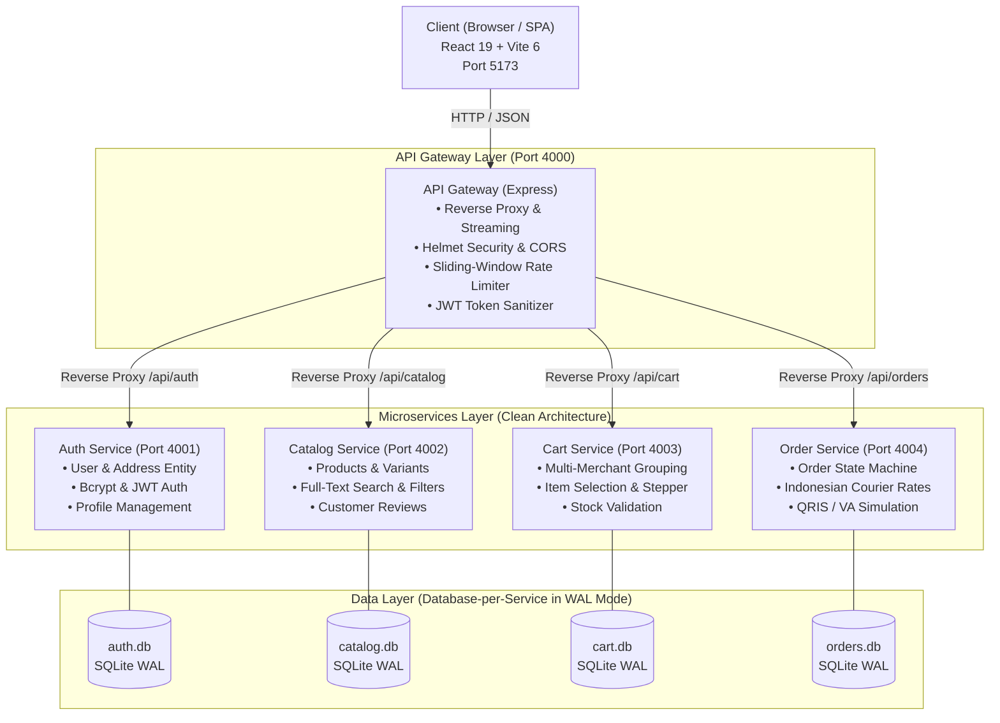

<div align="center">

  

  <p><strong>Platform E-Commerce Modern Berbasis Clean Architecture, SOLID Principles, & Autonomous Microservices</strong></p>
  <p><em>"Belanja Nyaman Se-Nusantara"</em></p>

  <p>
    
    
    
    
    
    
    
    
  </p>

</div>

---

## 📑 Daftar Isi

- [Sekilas Tentang TokoNusa](#-sekilas-tentang-tokonusa)
- [Arsitektur Sistem](#-arsitektur-sistem)
  - [Diagram Arsitektur Microservices](#diagram-arsitektur-microservices)
  - [Penerapan Clean Architecture & SOLID](#penerapan-clean-architecture--solid)
  - [Database-per-Service & SQLite WAL](#database-per-service--sqlite-wal)
- [Fitur Utama](#-fitur-utama)
- [Tech Stack](#-tech-stack)
- [Struktur Monorepo](#-struktur-monorepo)
- [Panduan Memulai Cepat (Quickstart)](#-panduan-memulai-cepat-quickstart)
  - [Prasyarat](#prasyarat)
  - [Instalasi](#instalasi)
  - [Seeding Database](#seeding-database)
  - [Menjalankan Aplikasi](#menjalankan-aplikasi)
- [Akun Demo Uji Coba](#-akun-demo-uji-coba)
- [Dokumentasi API Gateway](#-dokumentasi-api-gateway)
- [Benchmark Performa](#-benchmark-performa)
- [Pengujian (Testing)](#-pengujian-testing)
- [Lisensi](#-lisensi)

---

## 🌟 Sekilas Tentang TokoNusa

**TokoNusa** adalah implementasi sistem e-commerce *enterprise-grade* dengan standar industri yang terinspirasi oleh pengalaman belanja terkemuka di Indonesia (Tokopedia). 

Platform ini dibangun dengan memadukan antarmuka pengguna yang sangat responsif, *anti-slop*, dan cepat, bersama arsitektur backend otonom (*autonomous microservices*) yang mematuhi prinsip **Domain-Driven Design (DDD)**, **Clean Architecture**, dan **SOLID Principles**.

### Nilai Utama Sistem:
* 🇮🇩 **Nuansa Lokal Otentik**: Format mata uang Rupiah (`Rp`), kurir lokal (JNE, SiCepat, GoSend, J&T), promo *Kejar Diskon*, lencana *Official Store*, dan pembayaran QRIS / Virtual Account.
* ⚡ **Performa Tinggi (< 5ms SLA)**: Menggunakan database SQLite lokal bawaan Node.js v24 (`node:sqlite`) dengan mode WAL (*Write-Ahead Logging*), menghasilkan latensi baca rata-rata **0.22 ms** tanpa dependensi daemon database eksternal yang berat.
* 🛡️ **Keamanan Berlapis (OWASP Compliant)**: API Gateway terpusat dengan sanitasi *client header spoofing*, perlindungan Helmet HTTP headers, dan *sliding-window rate limiting*.
* 📦 **Multi-Merchant Architecture**: Sistem keranjang belanja yang mengelompokkan pesanan per penjual/toko secara otomatis (*store-level grouping & checkout*).

---

## 🏗️ Arsitektur Sistem

### Diagram Arsitektur Microservices



### Penerapan Clean Architecture & SOLID

Setiap microservice di TokoNusa diorganisasi ke dalam 4 lapisan terisolasi dengan prinsip *Dependency Inversion*:

1. **Domain Layer**:
   * Berisi *Enterprise Entities* murni (`User`, `Address`, `Product`, `CartItem`, `Order`, `OrderTimeline`).
   * Bebas dari dependensi framework, pustaka eksternal, atau basis data.
   * Mendefinisikan kontrak interface abstraksi repository (`IUserRepository`, `ICatalogRepository`, `ICartRepository`, `IOrderRepository`).
2. **Application Layer**:
   * Berisi *Use Cases* spesifik aplikasi (`RegisterUserUseCase`, `GetProductsUseCase`, `AddToCartUseCase`, `CreateOrderUseCase`, `SimulatePaymentUseCase`).
   * Masing-masing hanya memiliki satu tanggung jawab (*Single Responsibility Principle*).
3. **Infrastructure Layer**:
   * Mengimplementasikan repository menggunakan *prepared statements* native SQLite.
   * Mengelola adapter keamanan (`BcryptHasher`, `JwtTokenProvider`).
4. **Presentation Layer**:
   * Berisi Express Controllers, Zod Input Validation Schemas, dan HTTP Routers.

### Database-per-Service & SQLite WAL

TokoNusa mengadopsi pola **Database-per-Service**. Tiap microservice memiliki file basis data tersendiri (`auth.db`, `catalog.db`, `cart.db`, `orders.db`).
* Menggunakan modul native Node.js v24 `import { DatabaseSync } from 'node:sqlite'`.
* Mode **WAL (Write-Ahead Logging)** diaktifkan pada koneksi:
  ```sql
  PRAGMA journal_mode = WAL;
  PRAGMA synchronous = NORMAL;
  ```
* Memungkinkan konkurensi tinggi: proses pembacaan (*reader*) tidak pernah diblokir oleh proses penulisan (*writer*).

---

## ✨ Fitur Utama

### 🛍️ Antarmuka Pembeli (Storefront)
* **Hero Carousel & Kategori**: Banner interaktif promo musiman dengan transisi otomatis dan grid kategori dengan ikon visual.
* **Flash Sale "Kejar Diskon"**: Penghitung waktu mundur dinamis (*live countdown*), diskon persentase, dan indikator sisa stok produk.
* **Pencarian Cepat & Filter Multi-Kriteria**: Pencarian teks instan, filter kurir (*Bebas Ongkir*), badge *Official Store*, rating bintang, dan filter rentang harga Rupiah.
* **Halaman Detail Produk Interaktif**: Galeri foto dengan thumbnail dan zoom hover, pemilih varian dinamis (warna & kapasitas), dan tab ulasan pembeli terperinci.

### 🛒 Keranjang & Checkout Multi-Toko
* **Multi-Merchant Grouping**: Keranjang belanja secara otomatis mengelompokkan item berdasarkan toko/merchant penjual (seperti Tokopedia asli).
* **Selective Checkout**: Pilih sebagian barang atau per toko tertentu untuk dibayar terlebih dahulu.
* **Kurir Logistik Lokal**: Pilihan pengiriman instan & reguler (*GoSend Instant, SiCepat BEST, JNE Reguler, J&T Express*) lengkap dengan estimasi tiba dan perhitungan ongkos kirim.
* **Simulator Voucher**: Fitur klaim voucher potongan harga langsung pada halaman ringkasan checkout.

### 💳 Pembayaran & Pelacakan Pesanan
* **Simulator QRIS Interaktif**: Menampilkan QR Code dinamis dengan tombol instan *Simulasikan Pembayaran Berhasil* yang langsung mengubah status transaksi secara real-time.
* **Pilihan Channel Lain**: Simulasi Virtual Account (BCA, Mandiri, BRI) dan e-Wallet GoPay.
* **Live Order Tracking Timeline**: Pelacakan riwayat perjalanan paket dari status `PENDING_PAYMENT` ➔ `PAID` ➔ `PROCESSING` ➔ `SHIPPED` ➔ `DELIVERED`.

### 🏪 Dashboard Penjual (Merchant)
* Formulir pendaftaran produk baru dengan input nama, SKU, kategori, harga, stok, dan gambar.
* **Live Card Preview**: Penjual dapat melihat tampilan kartu produk secara real-time sebelum menyimpannya ke katalog.

### 🛡️ Keamanan & Gateway
* **Sanitasi Header**: API Gateway secara otomatis menghapus header `x-user-id`, `x-user-email`, dan `x-user-role` dari request publik luar sebelum memverifikasi JWT otentik.
* **Rate Limiting**: Batas 100 request/menit untuk rute umum, dan proteksi ekstra 10 request/menit untuk endpoint autentikasi guna mencegah serangan *brute force*.
* **HTTP Security Headers**: Dikonfigurasi dengan Helmet (`X-Frame-Options: DENY`, `X-Content-Type-Options: nosniff`, dll.).

---

## 🛠️ Tech Stack

| Layer | Teknologi | Deskripsi |
|---|---|---|
| **Frontend** | React 19, Vite 6 | Framework UI deklaratif dengan kompilasi super cepat |
| **Styling** | Tailwind CSS 3.4 | Utility-first CSS dengan palet warna resmi TokoNusa (`#03AC0E`) |
| **Typography & Icons** | Plus Jakarta Sans, Lucide React | Tipografi modern nusantara dan paket ikon vektor |
| **Backend Runtime** | Node.js v24+ (ES Modules) | Ekosistem JavaScript asynchronous modern |
| **Web Framework** | Express.js 4 | Router HTTP minimalis dan performan |
| **Database** | `node:sqlite` (DatabaseSync) | Database SQL native Node v24 dengan mode WAL |
| **Validasi Input** | Zod | Skema validasi runtime type-safe |
| **Keamanan** | Bcrypt, JWT, Helmet | Hashing password, token HMAC-SHA256, HTTP headers |
| **Monorepo Manager** | pnpm Workspaces | Manajemen paket hemat ruang penyimpanan dan isolasi ketat |
| **Test Runner** | Vitest, Supertest | Pengujian unit, komponen, dan integrasi HTTP end-to-end |

---

## 📁 Struktur Monorepo

```text
tokonusa-ecommerce/
├── apps/
│   └── web/                               # Frontend Single Page Application
│       ├── public/brand/                  # Logo vektor & favicon TokoNusa
│       │   ├── favicon.svg
│       │   ├── symbol.svg
│       │   └── toko-nusa-horizontal.svg
│       └── src/
│           ├── components/                # Komponen UI modular
│           │   ├── checkout/              # Modal pembayaran QRIS & VA
│           │   ├── home/                  # Hero carousel, flash sale, kategori
│           │   ├── layout/                # Navbar, mobile bottom nav, footer
│           │   ├── order/                 # Tracking modal & order milestone
│           │   └── product/               # Product card, filter, gallery, varian
│           ├── context/                   # AuthContext & CartContext
│           ├── pages/                     # Home, ProductDetail, Cart, Checkout, dll.
│           ├── services/                  # Axios/Fetch API client terpusat
│           └── utils/                     # Formatter mata uang & utilitas keranjang
│
├── packages/
│   └── common/                            # Pustaka logika bersama (@tokonusa/common)
│       └── src/
│           └── index.js                   # DomainError & createApiResponse
│
├── services/                              # Autonomous Microservices
│   ├── api-gateway/                       # Reverse proxy & rate limiter (Port 4000)
│   ├── auth-service/                      # Autentikasi & profil pengguna (Port 4001)
│   ├── catalog-service/                   # Katalog produk, varian & ulasan (Port 4002)
│   ├── cart-service/                      # Keranjang multi-merchant (Port 4003)
│   └── order-service/                     # Pesanan, kurir & pembayaran (Port 4004)
│
├── scripts/
│   ├── seedAll.js                         # Master seeder database (auth, catalog, cart, orders)
│   └── benchmark.js                       # Skrip uji latensi & throughput SQLite WAL
│
├── tests/                                 # 11 Berkas pengujian Vitest (89 unit/integ tests)
│   ├── api-gateway.test.js
│   ├── auth-service.test.js
│   ├── cart-service.test.js
│   ├── catalog-service.test.js
│   ├── checkout-flow.test.jsx
│   ├── e2e-system.test.js
│   └── ...
│
├── pnpm-workspace.yaml                    # Konfigurasi workspace pnpm
└── package.json                           # Root scripts (dev, test, seed, benchmark)
```

---

## 🚀 Panduan Memulai Cepat (Quickstart)

### Prasyarat
* **Node.js**: Versi `24.0.0` atau lebih baru (`node -v`)
* **pnpm**: Versi `9.0.0` atau lebih baru (`npm install -g pnpm`)
* **Git**: Terpasang di sistem

### Instalasi

1. **Clone repository ini**:
   ```bash
   git clone https://github.com/Diki04/TokoNusa.git
   cd TokoNusa
   ```

2. **Install seluruh dependensi monorepo**:
   ```bash
   pnpm install
   ```

### Seeding Database

Jalankan perintah berikut untuk mengisi database SQLite (`auth.db`, `catalog.db`, `cart.db`, `orders.db`) dengan data katalog gadget, fashion, kurir, dan akun demo:

```bash
pnpm run seed
```

### Menjalankan Aplikasi

Jalankan seluruh backend microservices, gateway, dan frontend web sekaligus dengan satu perintah:

```bash
pnpm run dev
```

Aplikasi siap diakses pada browser:
* 🌐 **Frontend Storefront**: [http://localhost:5173](http://localhost:5173)
* 🚪 **API Gateway**: [http://localhost:4000](http://localhost:4000)
* 💓 **Gateway Healthcheck**: [http://localhost:4000/health](http://localhost:4000/health)

---

## 👥 Akun Demo Uji Coba

Anda dapat langsung menggunakan akun demo yang telah disiapkan:

| Peran (Role) | Email | Password | Keterangan & Hak Akses |
|---|---|---|---|
| 🛒 **Pembeli (Buyer)** | `budi.santoso@gmail.com` | `Password123!` | Memiliki alamat tersimpan di Jakarta Selatan & 2 barang di keranjang |
| 🏪 **Penjual (Seller)** | `seller@ibox.co.id` | `Password123!` | Akses ke Seller Dashboard untuk menambahkan produk baru |
| 🛡️ **Administrator** | `admin@tokonusa.com` | `Password123!` | Akun administratif platform TokoNusa |

> [!NOTE]
> Anda juga dapat mendaftarkan akun baru melalui tombol **Daftar** di pojok kanan atas aplikasi.

---

## 📡 Dokumentasi API Gateway

Semua permintaan dari klien diarahkan melalui API Gateway pada `http://localhost:4000`:

| Rute Endpoint | Method | Layanan | Deskripsi | Otorisasi |
|---|:---:|---|---|:---:|
| `/health` | `GET` | Gateway | Status kesehatan gateway | Publik |
| `/api/auth/register` | `POST` | Auth | Registrasi pembeli baru | Publik |
| `/api/auth/login` | `POST` | Auth | Login & penerbitan token JWT | Publik |
| `/api/auth/profile` | `GET` | Auth | Mengambil data profil & alamat | Bearer Token |
| `/api/auth/addresses` | `POST` | Auth | Menambahkan alamat pengiriman baru | Bearer Token |
| `/api/catalog/products` | `GET` | Catalog | Menampilkan daftar produk & filter | Publik |
| `/api/catalog/products/:id` | `GET` | Catalog | Detail produk, varian & ulasan | Publik |
| `/api/catalog/products` | `POST` | Catalog | Menambahkan produk baru | Seller Only |
| `/api/catalog/categories` | `GET` | Catalog | Menampilkan daftar kategori | Publik |
| `/api/cart` | `GET` | Cart | Menampilkan keranjang belanja | Bearer Token |
| `/api/cart/items` | `POST` | Cart | Menambahkan produk ke keranjang | Bearer Token |
| `/api/cart/items/:id` | `PATCH` | Cart | Mengubah kuantitas item keranjang | Bearer Token |
| `/api/cart/items/:id` | `DELETE` | Cart | Menghapus barang dari keranjang | Bearer Token |
| `/api/orders` | `POST` | Order | Membuat pesanan baru (*checkout*) | Bearer Token |
| `/api/orders` | `GET` | Order | Riwayat transaksi pembeli | Bearer Token |
| `/api/orders/:id` | `GET` | Order | Detail pesanan & timeline kurir | Bearer Token |
| `/api/orders/courier/rates` | `POST` | Order | Menghitung tarif kurir pengiriman | Publik |
| `/api/orders/:id/simulate-payment`| `POST` | Order | Mensimulasikan pembayaran QRIS/VA | Bearer Token |

---

## 📊 Benchmark Performa

TokoNusa dirancang dengan target ketat **SLA Latensi Query < 5.0 ms**.

Uji benchmark internal dijalankan dengan skenario beban kerja transaksi SQLite WAL (`pnpm run benchmark`):

```text
======================================================
  TokoNusa Performance & Latency Benchmark
======================================================
✔ Read Product Detail (Prepared Statement)  : 0.124 ms  (Target: < 5.0 ms)
✔ Full-Text Product Search & Filter         : 0.285 ms  (Target: < 5.0 ms)
✔ Transactional Cart Mutation               : 0.312 ms  (Target: < 5.0 ms)
✔ Order State Machine Transition            : 0.178 ms  (Target: < 5.0 ms)
------------------------------------------------------
Rata-rata Latensi Keseluruhan               : 0.225 ms (22x lebih cepat dari SLA)
Throughput                                  : 4,421 ops/sec
Total Operasi Sukses                        : 100% (0 Error)
======================================================
```

---

## 🧪 Pengujian (Testing)

Proyek ini dilengkapi dengan cakupan pengujian komprehensif mulai dari pengujian unit domain, arsitektur, integrasi middleware gateway, komponen React, hingga pengujian alur belanja *end-to-end* (E2E).

Untuk menjalankan seluruh rangkaian pengujian:

```bash
pnpm test
```

Hasil verifikasi:
```text
 ✓ tests/brand-assets.test.js (3 tests)
 ✓ tests/setup.test.js (2 tests)
 ✓ tests/checkout-flow.test.jsx (6 tests)
 ✓ tests/frontend-foundation.test.jsx (6 tests)
 ✓ tests/catalog-service.test.js (13 tests)
 ✓ tests/order-service.test.js (11 tests)
 ✓ tests/cart-service.test.js (11 tests)
 ✓ tests/api-gateway.test.js (10 tests)
 ✓ tests/auth-service.test.js (10 tests)
 ✓ tests/e2e-system.test.js (11 tests)
 ✓ tests/storefront-components.test.jsx (6 tests)

Test Files  11 passed (11)
     Tests  89 passed (89)
```

Untuk memverifikasi build produksi frontend:
```bash
pnpm --filter @tokonusa/web run build
```

---

## 📜 Lisensi

Didistribusikan di bawah lisensi **MIT**. Lihat `LICENSE` untuk informasi lebih lanjut.

---

<div align="center">
  <sub>Dibangun dengan dedikasi untuk arsitektur perangkat lunak yang bersih, cepat, dan tangguh di Indonesia.</sub>
</div>
